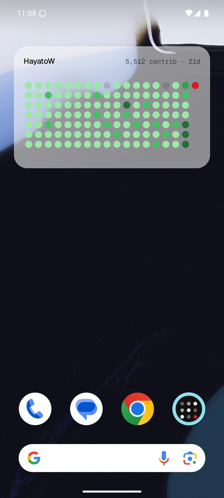

# Nothing Grass

GitHub のコントリビューション（草）を Nothing OS 5 風の半透明カードで表示する Android ホーム画面ウィジェット（Kotlin + Jetpack Glance）。



## 使い方
1. アプリを開いて GitHub ユーザー名を入れ「保存して更新」。
2. 「ホーム画面に追加」またはランチャーのウィジェット一覧から「GitHub の草」を置く（リサイズ対応、高さが低いとヘッダーを省略）。
3. ウィジェットをタップすると再取得。2 時間ごとに自動更新（WorkManager）。

色はモノクロ / GitHub 緑 / 壁紙連動（Android 12+ の Material You アクセント）。今日のマスは Nothing レッド。

## データ
- 標準: `https://github.com/users/<login>/contributions` の公開 HTML（トークン不要、公開分のみ）。
- 任意: トークンを入れると GitHub GraphQL `contributionCalendar` を使い、非公開リポジトリ分も含む。トークンは端末内 DataStore にのみ保存。

## 見た目の制約
半透明・細い枠線・角丸・Geist フォントで Nothing OS 5 の素材感に寄せています。背景をぼかすフロスト効果はサードパーティのウィジェットから使える公開 API がないため、半透明＋ハイライトで近似しています。

## ビルド
```
./gradlew testDebugUnitTest assembleDebug connectedDebugAndroidTest
```

Geist / Geist Mono は SIL Open Font License 1.1（`FONT-LICENSE-Geist.txt`）。
